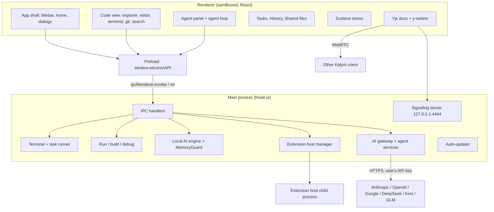

# Kalynt Architecture

This document describes how Kalynt 2.0 is put together: the two Electron processes, how they talk, and where each feature lives in the code.

## 1. Overview

Kalynt is a local-first desktop IDE with an AI agent and peer-to-peer collaboration. It is an Electron app in an npm-workspaces monorepo:

| Package | Purpose |
|---|---|
| `apps/desktop` | The Electron app: main process (`electron/`) and React renderer (`src/`) |
| `apps/mobile` | Android companion app, built and shipped separately (see [README_KALYNT_MOBILE.md](./README_KALYNT_MOBILE.md)) |
| `packages/crdt` | Shared Yjs CRDT helpers |
| `packages/networking` | WebRTC connection helpers |
| `packages/shared` | Common types and utilities |
| `packages/native-macos` | Swift helper process for macOS (FSEvents, CoreML, memory trimming) |



## 2. Process model and security boundary

- **Renderer.** Runs with `contextIsolation: true`, `sandbox: true` and `nodeIntegration: false`. It has no Node.js access; everything that touches the disk, spawns a process or loads a model goes through `window.electronAPI`.
- **Preload** (`electron/preload.ts`, assembled from `electron/preload/*`). Exposes a typed API over `ipcRenderer`. Every `on*` subscription returns its own unsubscribe function, so components clean up their listeners without removing anyone else's.
- **Main process** (`electron/main.ts`). Registers the IPC handlers, creates the window (`appWindow.ts`, which also applies the Content Security Policy to every response), starts the signaling server and the extension host, and initialises the updater. On quit, it stops every process Kalynt started before exiting (at most three seconds).

Guards applied in the main process:

| Concern | Where | What it does |
|---|---|---|
| File access | `utils/pathValidator.ts` | Every path is resolved against the workspace folder and checked again through `realpath`, so `..` and symlinks can't escape it |
| Process spawning | `handlers/code-exec/`, `terminal/dependencyManager.ts` | Commands are argument lists (`shell: false`), parsed with a shell-style tokenizer; there is no shell interpolation |
| Agent commands | `agent/exec.ts`, `src/services/agent/approvals.ts` | The agent's `run_command` goes through the user's shell, because it has to run pipelines and scripts. Commands ask first unless the user chose *Full auto*, and commands that look destructive or need elevated rights (`sudo`, `rm -rf`, force push, `git reset --hard`, piping a download into a shell, …) always ask. Stop kills the whole process tree |
| Agent web access | `agent/web.ts`, `agent/netGuard.ts` | Fetches are public-internet only: the host is resolved and every redirect hop is checked, and a local or private address is refused unless the user approved that URL |
| Secrets | `handlers/safeStorage.ts`, `ai/index.ts` | API keys and the GitHub token are encrypted with Electron `safeStorage` and written atomically, owner-only. Provider keys are read only by the main-process AI gateway; the renderer learns only which providers have one |
| Git credentials | `handlers/git.ts` | Tokens are passed per command and never written to `.git/config`; clone rejects option-like and `file://` URLs |
| Extensions | `extensions/` | Downloads only from Open VSX; VSIX entries can't write outside their folder; the host runs as a separate process with a restricted environment |
| Deep links | `main.ts` | `kalynt://` links are validated before reaching the renderer |
| Network listeners | `signalingServer.ts`, `mobileBridge.ts` | The signaling server binds to `127.0.0.1`; the mobile bridge starts only when a phone is paired |

## 3. Main process (`apps/desktop/electron`)

### 3.1 IPC handlers (`handlers/`)

| Handler | Responsibility |
|---|---|
| `file-system.ts`, `fs-search.ts`, `fs-backup.ts` | Workspace folder, read/write/rename/delete, folder watching, search (ripgrep with a JavaScript fallback), folder backup |
| `git.ts` | Status, diff, stage, commit, branches, fetch/pull/push, log, clone (simple-git) |
| `terminal.ts` | PTY terminals; killing a terminal kills its whole process tree and reports the exit |
| `code-execution.ts`, `code-exec/` | **Run**: 25 languages, run from the real file, process tracking, stdin |
| `build.ts`, `build-tasks.ts` | **Build**: tasks from `tasks.json` (JSONC), npm scripts and other providers |
| `debug.ts`, `debug/` | **Debug**: Debug Adapter Protocol transport, adapters (debugpy, js-debug, GDB, Delve), launch configurations, sessions |
| `dependency.ts` | Package manager commands (npm, pip, cargo, …) |
| `runtime.ts` | Language runtime detection, install and uninstall (`services/runtime-manager.ts`, `services/runtimes/`) |
| `llm-inference.ts`, `llm/engine.ts` | Local models via node-llama-cpp: load, stream, cancel, JSON-schema output, draft-model speculative decoding |
| `model-download.ts` | Model downloads with pause/resume, Range fallback and partial-file cleanup |
| `safeStorage.ts` | Encrypted secret storage |
| `nuke-handler.ts` | "Stop all processes" (calls `services/shutdown.ts`) |
| `update-handler.ts` | electron-updater against GitHub releases; downloads only with consent, never downgrades |
| `app-info.ts` | Version, paths, hardware information |

### 3.2 AI gateway and agent services (`ai/`, `agent/`)

Every cloud model request goes through the main process, so keys are used only there (the renderer keeps no copy) and there are no CORS limits. `ai/index.ts` registers `ai:chat` (streamed as `ai:event`), `ai:cancel`, `ai:models`, `ai:verify` and `ai:key-status`, and retries rate limits and overloads before anything has streamed. Each provider has its own adapter, all producing one conversation format (`src/types/aiProtocol.ts`) with native tool calling and streamed reasoning:

| Adapter | Providers | Notes |
|---|---|---|
| `ai/anthropic.ts` | Claude | Official SDK; adaptive thinking with summarized display, effort, prompt caching, server-side fallbacks for Opus, Fable and Sonnet; thinking blocks are kept and replayed |
| `ai/openaiResponses.ts` | OpenAI | Responses API, stateless (`store: false`) with encrypted reasoning items passed back each turn |
| `ai/openaiChat.ts` | DeepSeek, Kimi (Moonshot), GLM (Z.ai) | OpenAI-compatible Chat Completions; each provider's thinking and token parameters; `reasoning_content` is passed back as these APIs require |
| `ai/gemini.ts` | Gemini | `streamGenerateContent` over SSE; thought signatures replayed; tool schemas converted to Gemini's subset |

`ai/models.ts` asks each provider which models the key can use and merges that with the curated list in `src/types/aiProviders.ts`, leaving out retired and non-chat models.

`agent/` holds what the agent's tools need from Node: `exec.ts` (commands with a non-interactive environment, background processes, output capped at 2 MB), `files.ts` (glob and grep over git-tracked and untracked files), `web.ts` (search through DuckDuckGo with Bing as a fallback, and page reading converted to text by `htmlToText.ts`) and `sessions.ts` (conversations saved to `<userData>/agent-sessions/`, owner-only).

### 3.3 Services (`services/`)

- **`shutdown.ts`**: `stopEverything()` stops terminals, running programs, builds, debug sessions, package commands, agent commands and AI requests. It's shared by "Stop all" and app quit, and touches only processes Kalynt started.
- **`memoryGuard.ts`**: AIME's MemoryGuard. While a local model is loaded it reads available memory every five seconds, unloads the model before the system would start swapping, and can unload it after a period of inactivity. The renderer is told through `llm:unloaded`.
- **`Performance_Acceleration/`**: power modes (balanced, high performance, power saver), GC scheduling, process priority, and the inference tuning (threads, batch size, speculative decoding) that each mode implies.
- **`hardware-service.ts`**: CPU, memory, GPU and disk information plus live usage.
- **`native-helper-service.ts`**: JSON-RPC over stdin/stdout to the Swift helper on macOS.
- **`binary-manager.ts`**, **`runtime-manager.ts`**, **`runtimes/`**: finding and installing toolchains.

### 3.4 Terminal and tasks (`terminal/`)

`terminalService.ts` and `terminalManager.ts` own the PTYs; `terminalEnv.ts` builds a clean environment; `shellIntegration.ts` tracks commands; `taskRunner.ts`, `taskProviders.ts` and `taskTypes.ts` implement build tasks; `languageGateway.ts`, `languageConfigs.ts` and `debugGateway.ts` map languages to runners and debuggers; `packageManagers.ts` holds the package-manager tables.

### 3.5 Extensions (`extensions/`)

`extensionHostManager.ts` forks `extensionHostProcess.ts`, which runs VS Code extensions against `vscodeApiShim.ts` (a subset of the VS Code API). `extensionInstaller.ts` downloads and unpacks VSIX files and `extensionRegistry.ts` tracks what is installed.

### 3.6 Collaboration and mobile

- **`signalingServer.ts`**: a y-webrtc-compatible signaling server on `127.0.0.1:4444`. Peers on other machines meet through the public y-webrtc signaling fallback, which only relays connection offers; document data flows directly between peers.
- **`mobileBridge.ts`**, **`mobilePairing.ts`**, **`mobileGithubProxy.ts`**, **`mobileAgentBridge.ts`**: the WebSocket bridge for the Android companion. It starts only when you pair a phone, and every pairing must be approved on the desktop.

## 4. Renderer (`apps/desktop/src`)

### 4.1 Application shell

`App.tsx` shows the splash screen until `useAppBootstrap` finishes, then the titlebar and either the **home screen** or the **workspace view**. Settings, collaboration, extensions and the command palette are lazy-loaded dialogs. Each region is wrapped in a `RegionBoundary`, so a crash in one panel shows an error in that panel instead of blanking the window.

| Folder (`src/components/`) | Contents |
|---|---|
| `shell/` | Titlebar, workspace switcher, peers and update indicators, toasts, update dialog, global shortcuts |
| `home/` | Home screen, workspace list, new-workspace and clone dialogs |
| `workspace/` | `WorkspaceView`: keeps the code view mounted and lazy-loads Tasks, History and Shared files |
| `ide/` | Code view: `IDEWorkspace` composes the activity bar, side panel, editor area, bottom panel, agent aside and status bar. Subfolders: `editor/` (Monaco setup, tabs, split view, inline completions), `explorer/`, `search/`, `git/`, `terminal/`, `hooks/` (open files, runner, folder watching, shortcuts) |
| `agent/` | Agent panel: `chat/` (conversation, model picker, tool approvals), `review/` (workspace review and fixes), `team/` (encrypted team chat) |
| `settings/` | Settings dialog and its pages, including AIME memory settings |
| `collaboration/` | Members, invite, join and activity |
| `extensions/` | Language runtimes (34-entry catalogue) and VS Code extensions |
| `palette/` | Command palette (files, `>` commands, `#` workspaces) |
| `tasks/`, `history/`, `files/` | Task board, git history, shared files |
| `system/` | Resource meters |
| `ui/` | Design-system primitives: buttons, form controls, popover, menu, dialog, confirm/prompt service, tabs, badges, virtual list, resizer, layer stack |

**Design system.** Colours, type, spacing, radii and motion are CSS variables in `styles/tokens.css`, defined for `:root[data-theme="dark"]` and `"light"`. `styles/base.css` holds the reset, focus styles and reduced-motion handling. Fonts (Instrument Sans, JetBrains Mono) are bundled. A shared layer stack (`ui/layers.ts`) gives every overlay consistent Escape and outside-click behaviour.

### 4.2 State (`src/stores/`)

| Store | Holds |
|---|---|
| `appStore` | Workspaces, current workspace, user name, theme; API keys are mirrored from `safeStorage`, never persisted to localStorage |
| `workspaceFolderStore` | Per-workspace folder, open tabs, active file, last opened |
| `layoutStore` | Panel sizes and visibility, editor preferences |
| `uiStore`, `commandStore`, `editorStatusStore`, `agentStatusStore` | Dialog state, command registry, cursor/language, agent activity |
| `agentSessionStore`, `modelStore`, `memberStore`, `notificationStore`, `updateStore` | Agent conversations (saved by the main process), local models, members, toasts, update state |

Workspace data that collaborators share (tasks, team chat, members) lives in Yjs documents (`hooks/useYjs.ts`), persisted to IndexedDB and synced over WebRTC.

### 4.3 The agent

The agent lives in `src/services/agent/`; the chat UI is `components/agent/chat/`.

- **`runner.ts`** runs the loop: send the conversation and tool definitions, stream text, reasoning and tool calls into the live view, ask for approval where needed, run the tools, and return every result before the next turn. Consecutive read-only calls run in parallel. A run stops after 60 steps with a *Continue* button, and Stop aborts the request and any running command while keeping what was already written.
- **Tools** (`tools/`): read, list, find and search files; edit (exact string replacement, read-before-edit enforced) and write, delete and move; run commands, in the foreground or in the background with `command_output` and `stop_command`; web search and fetch; a plan the UI shows as a checklist; semantic search over AIME's index; diagnostics; git status and diff. Edits to Python, JavaScript, JSON and shell files are syntax-checked right away (`diagnostics.ts`), and `get_diagnostics` runs the project's own TypeScript compiler, `go vet` or `cargo check`.
- **Approvals** (`approvals.ts`): three modes. *Ask before changes* approves each edit and command, *Auto-edit* applies edits directly, and *Full auto* runs everything except risky commands, which always ask. "Always allow" remembers a command prefix (never inline code or shell operators), a tool, or a local host for the rest of the conversation.
- **Undo** (`checkpoints.ts`): every file is snapshotted before its first change in a run, so *Undo* restores the run's edits, creations and deletions.
- **Context** (`systemPrompt.ts`, `messageContext.ts`, `compaction.ts`): the system prompt is fixed for a conversation so provider prompt caches stay valid; `@file` mentions and the open editor are attached to messages; long conversations are summarized when they near the model's context window.
- **Local models** (`localModel.ts`): a reduced tool set described in the prompt, with tool calls parsed from ```` ```tool ```` blocks (and the `<tool_call>` and JSON forms local models tend to use).
- **Other AI features** (code review, task steps, inline completions) use `services/aiService.ts`, a small wrapper over the same gateway.
- **Models:** `src/types/aiProviders.ts` is the curated list of cloud models per provider. The live list from each provider adds new models and drops retired ones automatically; check the curated list before each release anyway. `services/offlineLLMService.ts` talks to the local engine in the main process.
- **AIME:** `services/aimeService.ts` indexes the workspace in a Web Worker (`workers/aimeWorker.ts`) for retrieval, and `types/aime.ts` defines the local-model memory configuration that MemoryGuard and the engine use.

### 4.4 Collaboration

`p2pService.ts` and `collabEngine.ts` manage Yjs documents over y-webrtc. When a workspace has a room password, `encryptionService.ts` derives a key with PBKDF2 and `encryptedProvider.ts` encrypts every update with AES-256-GCM before it leaves the machine; without a password, anyone with the invite link can join and read. `memberSyncService.ts` and `peerAuthService.ts` handle members and roles, and `fileTransferService.ts` sends shared files (up to 200 MB) directly between peers.

## 5. Build and packaging

- **Vite** builds three bundles: the renderer (`dist/`), the main process (`dist-electron/main.js`, one self-contained file) and the preload and extension-host scripts. Production builds use Terser with `passes: 1` (a second pass breaks Monaco) and keep `console.error`/`console.warn`.
- **electron-builder** produces NSIS (Windows), DMG (macOS) and AppImage/deb (Linux) packages. `node-llama-cpp` and its native binaries ship outside `app.asar` (`extraResources`). The **`scripts/after-pack.cjs`** hook copies node-llama-cpp's runtime dependencies next to it; without them the packaged app can't load the engine.
- **Releases** come from CI (`.github/workflows/build.yml`): every push to `main` builds all three platforms and publishes them to the GitHub release named after `apps/desktop/package.json`'s version. The updater reads that release.

## 6. Testing

There is no unit-test suite yet. Releases are verified by type-checking both projects (`tsc -p tsconfig.json` and `tsc -p tsconfig.node.json`) and by driving the built app (development and packaged) over the Chrome DevTools Protocol in a headless X server with an isolated profile. Suites exercise `window.electronAPI` directly: file system, git, run, build, debug, terminals, secure storage, model download and local inference. The AI adapters and the agent are driven through the real chat UI against a mock server that speaks each provider's streaming protocol (`KALYNT_AI_TEST_BASE_URL` points the gateway at it).

---

*Last updated: October 19, 2026 (v2.0.0)*
