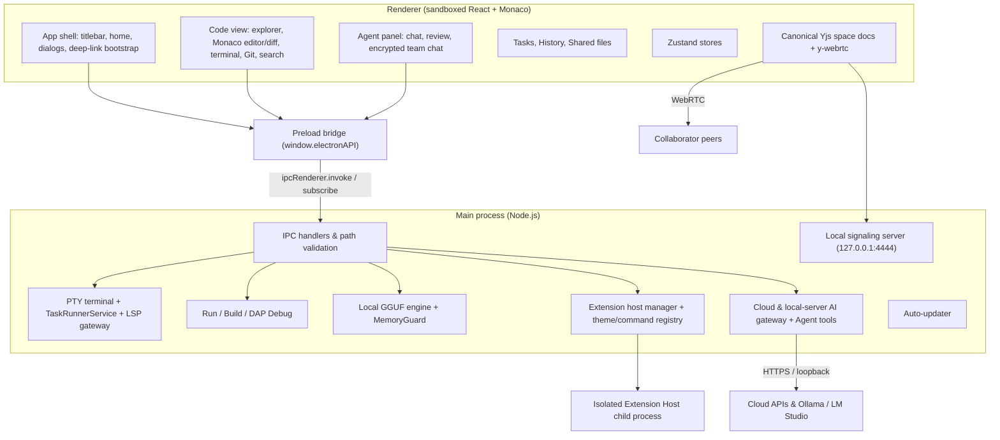

# Kalynt Architecture

This document describes the architecture of **Kalynt 2.1**: its two Electron processes, security boundaries, service modules, collaboration protocol, build pipeline, and automated verification strategy.

---

## 1. Overview

Kalynt is a local-first desktop IDE with an integrated AI agent and serverless peer-to-peer collaboration. It is organized as an npm-workspaces monorepo:

| Package | Responsibility |
| --- | --- |
| `apps/desktop` | Electron desktop application: main process (`electron/`), sandboxed React renderer (`src/`), and build/smoke scripts (`scripts/`) |
| `packages/crdt` | Shared Yjs CRDT helpers |
| `packages/networking` | WebRTC networking helpers |
| `packages/shared` | Shared types and utilities |
| `packages/native-macos` | Optional Swift helper process for macOS (FSEvents, CoreML, memory trimming) |

---

## 2. Process Model & Security Boundary

- **Renderer:** Runs with `contextIsolation: true`, `sandbox: true`, and `nodeIntegration: false`. It has zero direct Node.js access; every disk, process, keychain, and model operation passes through `window.electronAPI`. In browser preview mode (`npm run dev:web`), `src/electronShim.ts` supplies an explicit web shim that surfaces desktop-only limitations cleanly rather than failing silently.
- **Preload** (`electron/preload.ts`, composed from `electron/preload/{platformApi,workspaceApi,toolsApi,types}.ts`): Exposes a typed IPC API. Every `on*` listener returns an individual unsubscribe callback so components clean up safely without detaching sibling subscribers.
- **Main process** (`electron/main.ts`): Registers IPC handlers, creates the window (`appWindow.ts`, enforcing CSP headers on every response), queues cold-start `process.argv` and macOS `open-url` deep links until the renderer drains them (`deep-link:consume`), starts the loopback signaling server and extension host, and initializes `electron-updater`. On quit, `shutdownApp()` stops every Kalynt-owned process before exiting (bounded to 3 seconds).

### Main-Process Security Controls

| Concern | Implementation | Enforcement |
| --- | --- | --- |
| **Filesystem access** | `electron/utils/pathValidator.ts` | Resolves every path against the active workspace root via `fs.realpath`, preventing `..` and symlink escapes (including parent-symlink resolution for new files and Windows drive/UNC normalization). |
| **Process spawning** | `handlers/code-exec/`, `terminal/dependencyManager.ts` | Uses argument lists (`shell: false`) with shell-style argument parsing; no shell interpolation for Run or package managers. |
| **Agent commands** | `electron/agent/exec.ts`, `src/services/agent/approvals.ts` | Runs through the user's shell in a non-interactive environment behind three approval modes (*Ask before changes*, *Auto-edit*, *Full auto*). Destructive/elevated commands (`sudo`, `rm -rf`, force push, `git reset --hard`, pipe-to-shell, etc.) always prompt. Stop kills the entire process tree. |
| **Agent web fetches** | `electron/agent/web.ts`, `netGuard.ts` | Resolves DNS and validates every redirect hop against private/loopback IP ranges; local/private targets require explicit user approval. |
| **Secrets & keys** | `handlers/safeStorage.ts`, `electron/ai/index.ts` | Encrypts provider API keys, TURN credentials, room passwords, and GitHub tokens via OS keychain (`safeStorage`) with atomic, owner-only writes. Provider keys never return to the renderer. |
| **Git credentials** | `handlers/git.ts` | Passes tokens per invocation without writing to `.git/config`; clone rejects option-like and `file://` URLs. |
| **Extensions & themes** | `electron/extensions/` | Open VSX downloads only; VSIX extraction and JSONC theme `include` resolution guard against path traversal; extension host runs in a separate process with filtered environment variables. |
| **Deep links** | `electron/main.ts` | Validates `kalynt://join/<roomId>` protocol, host, segment syntax, raw `..` traversal, and query/hash payloads before queuing or forwarding to the renderer. |
| **Signaling server** | `electron/signalingServer.ts` | Binds strictly to `127.0.0.1:4444`. |

---

## 3. Main Process (`apps/desktop/electron`)

### 3.1 Core IPC Handlers (`handlers/`)

| Module | Responsibility |
| --- | --- |
| `file-system.ts`, `file-write.ts`, `fs-search.ts`, `fs-backup.ts` | Workspace lifecycle, atomic writes with compare-and-write conflict detection (preserving BOM, line endings, permissions, symlinks), watchers, ripgrep/JS search, and workspace backup. |
| `editor-state.ts` | Atomic, owner-only persistence of unsaved editor draft snapshots in `<userData>/editor-state/`, supporting debounced async writes and synchronous close/reload flushes. |
| `git.ts` | Status, diff, stage/unstage, commit, multi-remote non-detaching tracking branch checkout (`checkoutBranch`) & renamed-branch push (`pushBranch`), stash, fetch/pull, log, and clone via `simple-git`. |
| `terminal.ts` | PTY sessions (`terminalService.ts`), `TaskRunnerService` IPC, and LSP request/notification/diagnostic routing (`languageGateway.ts`). |
| `code-execution.ts`, `code-exec/` | Single-file execution across 25+ languages, sanitized Nim temporary module naming with awaited `finally` cleanup, and .NET 10+ `dotnet run --file` (with `.csproj`/`.csx`/`dotnet-script` and F# `fsi` support). |
| `build.ts`, `build-tasks.ts` | Build task detection and execution from `tasks.json` (JSONC), npm scripts, and project providers. |
| `debug.ts`, `debug/` | Debug Adapter Protocol (DAP) transport, launch configs, session manager with `getScopes(sessionId, frameId)`, Python (`debugpy`), C/C++ (`gdb`), Go (`dlv`), and standalone Microsoft `vscode-js-debug` (`js-debug-dap` TCP child-session `startDebugging` handshake). |
| `runtime.ts`, `services/runtime-manager.ts`, `services/runtimes/` | Detection, installation, and removal of 34 language runtimes (including `rustup-init` / `rustup-init.exe` basename preservation and managed Rust verification). |
| `llm-inference.ts`, `llm/engine.ts` | Local GGUF inference via `node-llama-cpp`: serialized queue, dynamic context sizing to available RAM, streaming, cancellation, JSON-schema grammar, speculative draft models, and Linux `LD_LIBRARY_PATH` resolution for `libffmpeg.so`. |
| `model-download.ts` | Curated GGUF downloads with pause/resume, HTTP 206/416 range verification, redirect protocol validation, and partial-file cleanup. |
| `nuke-handler.ts`, `services/shutdown.ts` | Shared `stopEverythingWithDetails()` / `shutdownApp()` stopping PTY terminals, active `TaskRunnerService` process trees, direct runs, build tasks, debug sessions, dependency installs, agent commands, and in-flight AI requests — reporting `complete`, `partial`, or `failed` cleanup status without touching unrelated OS processes. |
| `update-handler.ts` | Consent-gated GitHub Releases updates via `electron-updater`, downgrade protection, and platform-specific macOS `.zip`/`.dmg` guidance. |
| `safeStorage.ts`, `dependency.ts`, `app-info.ts` | Keychain secrets, package manager operations, and system/version metadata. |

### 3.2 AI Gateway & Agent Services (`ai/`, `agent/`)

All cloud and loopback local-server requests execute in the main process (`ai/index.ts`), exposing `ai:chat` (`ai:event` stream), `ai:cancel`, `ai:models`, `ai:verify`, `ai:key-status`, and local-server lifecycle handlers:

| Adapter | Providers | Protocol Details |
| --- | --- | --- |
| `ai/anthropic.ts` | Anthropic Claude | Official SDK; adaptive thinking, effort levels, prompt caching, thinking block replay. |
| `ai/openaiResponses.ts` | OpenAI | Stateless Responses API (`store: false`) with encrypted reasoning replay. |
| `ai/openaiChat.ts` | DeepSeek, Kimi (Moonshot), GLM (Z.ai), Ollama / LM Studio | OpenAI-compatible Chat Completions with provider-specific reasoning parameters, malformed tool-argument guards, and terminal finish-signal verification (`TruncatedStreamError` on premature EOF). |
| `ai/gemini.ts` | Google Gemini | SSE `streamGenerateContent`, thought-signature replay, schema adaptation, and explicit `finishReason` verification (`TruncatedStreamError` on premature EOF). |

`ai/models.ts` separates live catalog responses (`source: 'live'`, keeping empty/filtered 200 responses honest instead of inventing fallback models), auth errors (`source: 'error'`), and explicit offline fallbacks (`source: 'fallback'`, `live: false`).

`electron/agent/` provides sandboxed-workspace file discovery (`files.ts`), non-interactive command execution (`exec.ts`, 2 MB output cap), SSRF-checked web search/fetch (`web.ts`, `netGuard.ts`), and atomic per-workspace conversation storage (`sessions.ts` in `<userData>/agent-sessions/`).

### 3.3 Language Servers & Extensions (`terminal/`, `extensions/`)

- **LSP Gateway (`terminal/languageGateway.ts`, `languageConfigs.ts`):** Shares Python executable discovery (workspace `.venv`/`venv`, `VIRTUAL_ENV`, managed Python, `python3`/`python`) with the debugger/runner. Awaits OS spawn before JSON-RPC initialization, catches stream/early-exit errors cleanly without unhandled `ERR_STREAM_DESTROYED` rejections, routes document lifecycle calls (`initialized`, `didOpen`, `didChange`, `didSave`, `didClose`) over true JSON-RPC notifications (no `id`), and forwards server-pushed `textDocument/publishDiagnostics` to both the Problems panel and Monaco markers.
- **Extension Host (`extensions/`):** `extensionHostManager.ts` manages an isolated `extensionHostProcess.ts` implementing a subset of the VS Code API (`vscodeApiShim.ts`). Supports cold-start lazy scanning, on-demand activation, contributed Command Palette execution (`extensions:execute-command`), persisted disable/uninstall state, and JSONC color theme loading with traversal guards.

---

## 4. Renderer (`apps/desktop/src`)

### 4.1 Shell, UI & Design System

`App.tsx` waits for `useAppBootstrap` (store hydration, theme/extension theme application, update wiring, recovery flush guards, and draining queued deep links), then renders the shell and either `HomeScreen` or `WorkspaceView`. Each major panel is wrapped in a `RegionBoundary` for fault isolation.

- **Design system (`src/styles/tokens.css`, `src/components/ui/`):** Semantic CSS variables for dark/light themes, bundled Instrument Sans and JetBrains Mono fonts, accessible overlays managed by `ui/layers.ts`, and dynamic override support for contributed VS Code color themes (`services/extensions/themeService.ts` + `monacoThemeBridge.ts`).
- **Editor reliability (`components/ide/editor/`, `components/ide/git/`):**
  - `monacoDiffLifecycle.ts` & `MonacoDiffView.tsx`: owns dedicated `kalynt-diff://` models and detaches both models (`setModel(null)`) before disposing the diff editor, never disposing shared main-editor models.
  - `monacoReliability.ts` & `monacoSetup.ts`: filters ignore rules strictly on workspace-relative segments across `.ts/.tsx/.d.ts/.mts/.cts/.js/.jsx/.mjs/.cjs`, resolves `tsconfig`/`jsconfig` `paths`, and installs an idempotent cancellation handler suppressing normal Monaco/Abort cancellations without hiding real errors.
  - `useOpenFiles.ts`: enforces manual-save-only Format on Save (Auto-save modes skip formatting to protect cursor/undo state), falls back cleanly with a warning if a formatter fails, and handles disk-change conflicts atomically.

### 4.2 State & Workspace Review

- **Zustand stores (`src/stores/`):** `appStore`, `workspaceFolderStore`, `layoutStore`, `uiStore`, `commandStore`, `editorStatusStore`, `agentStatusStore`, `diagnosticsStore`, `agentSessionStore`, `modelStore`, `memberStore`, `notificationStore`, and `updateStore`.
- **Workspace Review (`services/workspaceScanService.ts`, `components/agent/review/`):** Discloses scan limits up front, supports both `sampled` and `full` coverage (with long-file chunking), reports discovered/analyzed/omitted/clipped counts by reason, and tracks explicit `completed`, `partial`, `canceled`, and `failed` outcomes while preserving already-returned findings.

### 4.3 Peer-to-Peer Collaboration (Protocol v2)

- **Canonical room document (`hooks/useYjs.ts`):** Ref-counted, normalized `roomId` document map shared across Team Chat, Tasks, Shared Files, Status Bar, and Peers Indicator. Automatically rebinds awareness listeners and `memberSyncService.updateAwareness()` whenever `p2pService.reconnect()` replaces a `WebrtcProvider` (such as after setting or clearing a room password).
- **Encryption & authentication (`services/encryptionService.ts`, `encryptedProvider.ts`, `p2pService.ts`):**
  - Protocol v2 derives a deterministic room salt (`SHA-256('kalynt:e2ee:v1:salt:' + roomId)`) followed by PBKDF2-SHA256 (100,000 iterations) and domain-separated HKDF-SHA256 keys: an AES-256-GCM encryption key, an HMAC-SHA256 integrity key, and a non-secret 16-byte `keyCheck` commitment.
  - Peers exchange protocol metadata (`version: 2`, `encrypted`, `keyCheck`) via awareness and `encryptionVersion: 2` on encrypted chat messages. Signaling-level decryption probes (`waitForRoomAuth`) distinguish `unencrypted`, `key-configured` (waiting for offline peers), `authenticated`, `auth-failed` (wrong password, with inline retry), `password-required`, and `protocol-mismatch` (incompatible Kalynt 2.0 peer).
- **Shared Files (`services/fileTransferService.ts`, `components/files/`):** Writes directly to the canonical room `Y.Doc` using 64 KiB chunks (`MAX_FILE_CHUNKS = 4096`), stores and verifies SHA-256 checksums on download, and tracks explicit local-only, sending, receiving, incomplete, and ready states.
- **Identity & moderation (`services/memberSyncService.ts`, `peerAuthService.ts`):** Uses ECDSA P-256 peer identities, signed ownership proofs, encrypted moderation actions, and durable signed `bannedRecords` in Yjs so bans disconnect guests live and on rejoin while remaining permanently inspectable and liftable by owners/admins.

---

## 5. Build & Packaging

- **Vite (`apps/desktop/vite.config.ts`):** Produces `dist/` (renderer), `dist-electron/main.js`, preload, and extension-host bundles. Terser uses `passes: 1` (required for Monaco compatibility) and retains `console.error`/`console.warn`.
- **Native modules & `electron-builder`:** `build.npmRebuild` is set to `false` in `apps/desktop/package.json` so `electron-builder` never triggers a nested workspace-pruning `npm install --production`. Instead, `npm run rebuild:native` explicitly runs `electron-rebuild --module-dir ../.. --only node-pty` (via direct devDependency `@electron/rebuild` `^4.0.3`, requiring Node `>= 22.12.0`). All local packaging scripts invoke `rebuild:native` before `electron-builder --publish never`.
- **Packaged AI runtime (`scripts/after-pack.cjs`):** Ships `node-llama-cpp` and `@node-llama-cpp/*` in `extraResources` outside `app.asar` and copies the hoisted runtime dependency closure into `resources/node_modules`.
- **Targets & CI (`.github/workflows/build.yml`, `verify.yml`):**
  - Linux: `AppImage` + `deb` + `latest-linux.yml`
  - Windows: NSIS x64 `.exe` + `latest.yml`
  - macOS: `dmg` + `zip` + `latest-mac.yml` (ZIP payload required by `electron-updater`'s `MacUpdater`)

---

## 6. Testing & Verification

| Command | Coverage |
| --- | --- |
| `npm test` | Discovers and runs all `*.test.mjs` suites under `apps/desktop/{electron,src}` (150+ unit & loopback integration tests covering AI adapters, local servers, GGUF engine, downloads, editor recovery, atomic saves, search, Git multi-remote checkout, Monaco diff/reliability, LSP gateway, DAP scopes & Node adapter, Rust installer, Nim/C# execution, TaskRunner shutdown, extensions/themes, Workspace Review, browser mode, and E2EE/collaboration) plus strict `tsc --noEmit` across `packages/{crdt,networking,shared}`. |
| `npm run lint` | ESLint across all TypeScript/TSX files including React Hooks and security rules. |
| `npm run typecheck --workspace=apps/desktop` | Renderer (`tsconfig.json`) and Electron main/preload (`tsconfig.node.json`) type checks. |
| `npm run typecheck:fixtures --workspace=apps/desktop` | Monaco editor interaction fixture type check. |
| `npm run website:build` | Builds the static landing website into `dist/website`. |
| `bash apps/desktop/scripts/smoke-linux-ci.sh` | Runs the isolated production Electron smoke suite (`scripts/smoke.cjs`) inside a disposable D-Bus + GNOME keyring + Xvfb session, testing preload isolation, FS, watchers, Git, real PTY spawn/resize/write/output/kill (plus missing-ID failure checks), tasks, agent tools/sessions, local-server streaming, optional Python `debugpy` (`KALYNT_SMOKE_PYTHON`), and optional GGUF inference (`KALYNT_SMOKE_MODEL`). With `KALYNT_SMOKE_RESOURCES`, also validates packaged `app.asar` version (`2.1.0`), bundle hashes, and packaged `node-llama-cpp` loading. |

*Updated for Kalynt v2.1.0 — November 21, 2026.*
