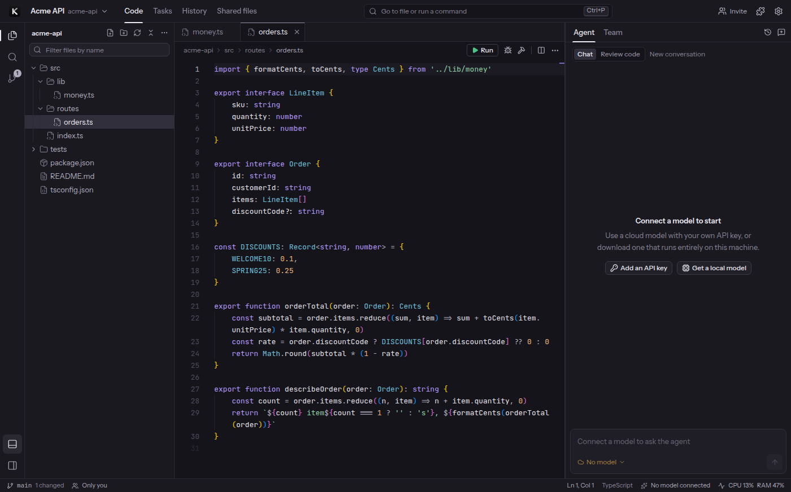
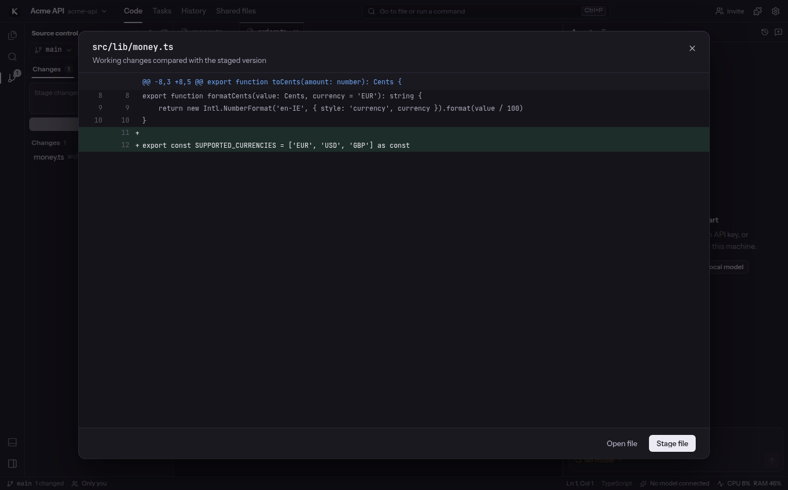
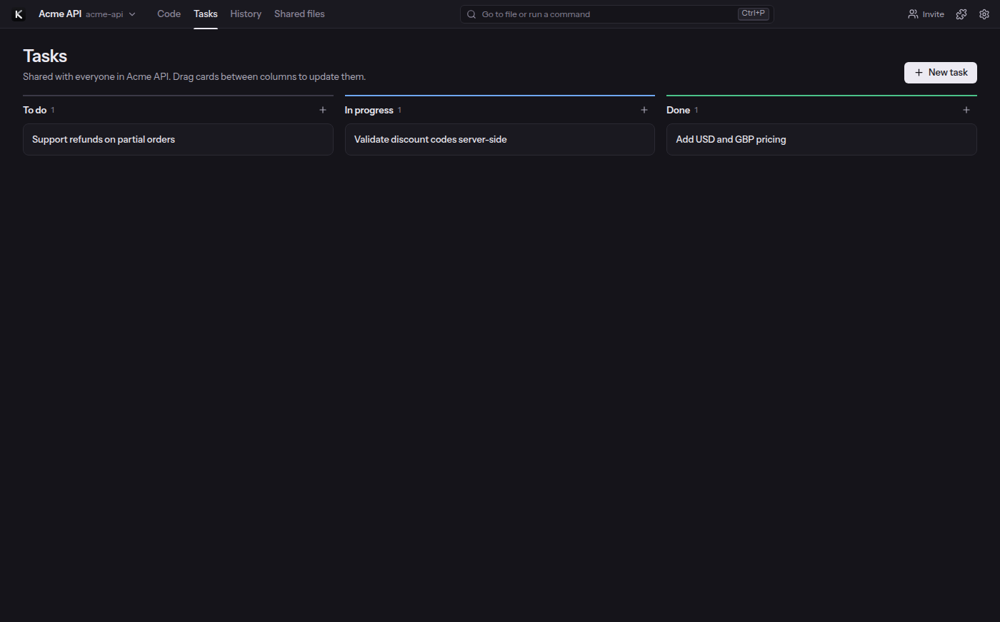
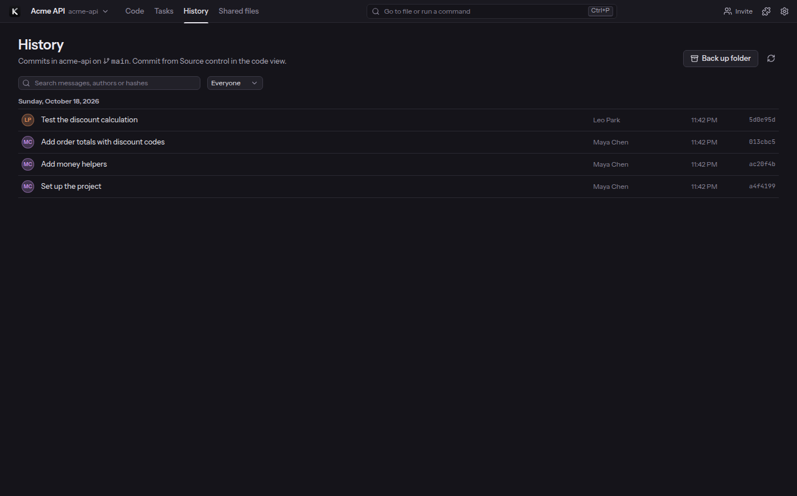
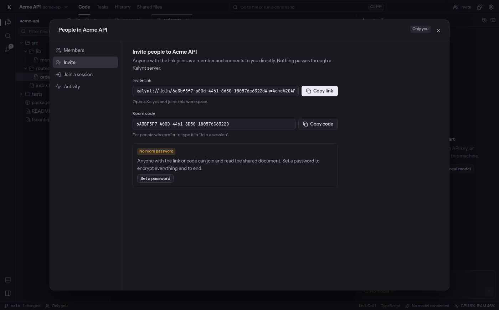
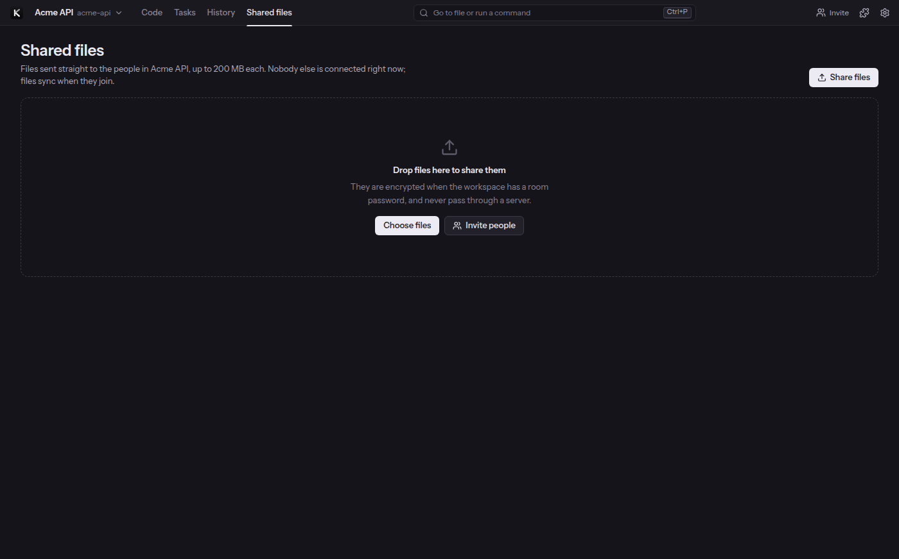
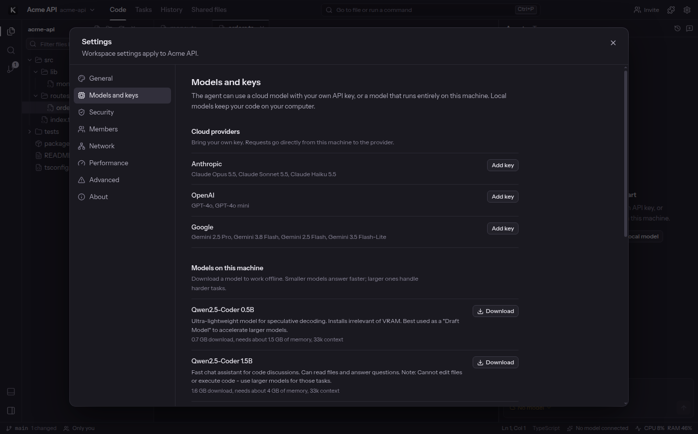
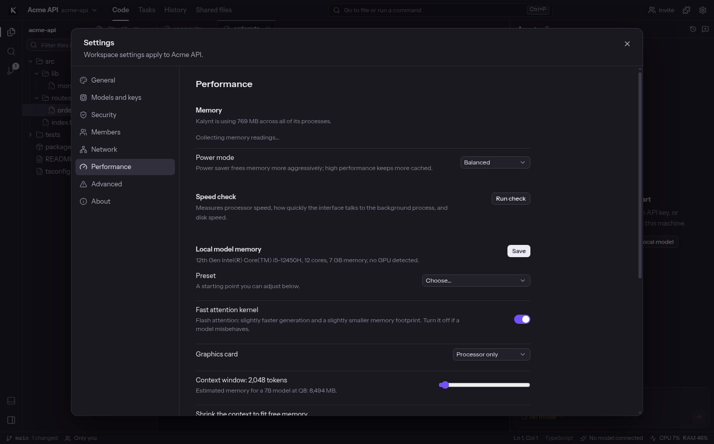
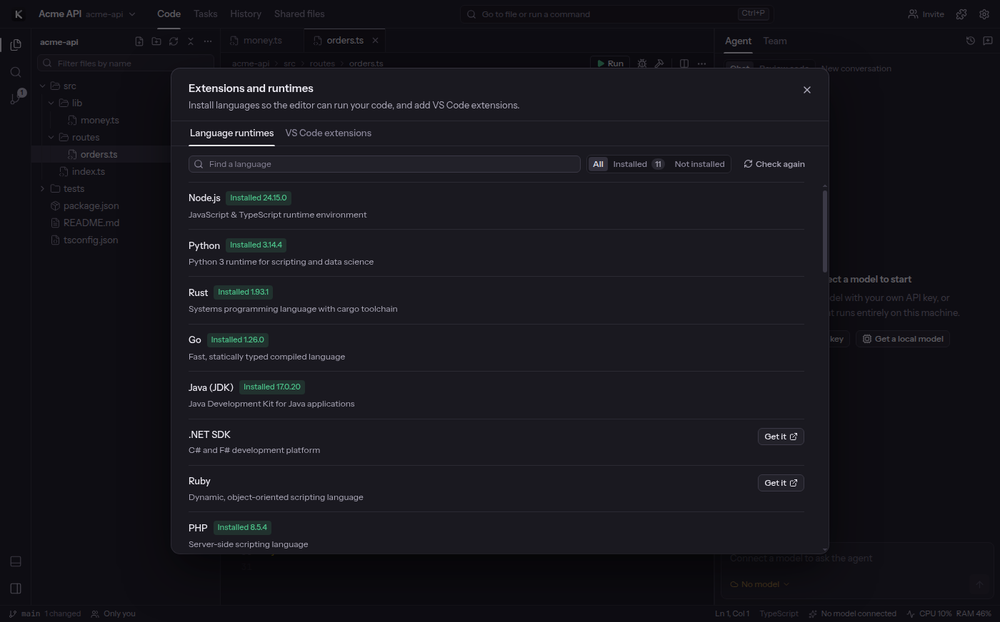

# Kalynt

<div align="center">
  

  <h3>Local-First AI IDE · Peer-to-Peer Collaboration · No Subscription Required</h3>

  <p>
    A desktop code editor with a built-in AI agent and direct WebRTC collaboration.
    Run local GGUF models on your own hardware, connect to local Ollama/LM Studio servers,
    or bring your own cloud API keys — with no intermediary Kalynt server.
  </p>

  [](https://www.gnu.org/licenses/agpl-3.0)
  [](https://github.com/hermes-lekkas/Kalynt/releases)
  [](https://github.com/hermes-lekkas/Kalynt/releases)
  [](https://reddit.com/r/Kalynt_IDE)
  [](https://youtu.be/pV7THS2ZGls)
  [](https://open.spotify.com/show/0Hm1TtyPtzpRkhGCZjaAbb)
</div>

<p align="center">
  <a href="https://github.com/hermes-lekkas/Kalynt/releases/latest"><strong>Download Latest Release</strong></a> ·
  <a href="https://hermes-lekkas.github.io/Kalynt/"><strong>Website & Setup Guide</strong></a> ·
  <a href="./ARCHITECTURE.md"><strong>Architecture</strong></a> ·
  <a href="./CHANGELOG.md"><strong>Changelog</strong></a> ·
  <a href="https://github.com/hermes-lekkas/Kalynt/discussions"><strong>Discussions</strong></a>
</p>

> No Kalynt account or subscription is required. Local models run on your machine; cloud providers bill API usage separately under your own key.

---

<div align="center">
  
</div>

<details>
  <summary><strong>More screenshots</strong></summary>

  ### Source control and side-by-side diffs
  

  ### Shared task board
  

  ### Git history
  

  ### Team and collaboration
  

  ### Peer-to-peer shared files
  

  ### Models and API keys
  

  ### Local model memory (AIME)
  

  ### Language runtimes
  

</details>

---

## Quick Start

1. **Install:** Download the package for your platform from [GitHub Releases](https://github.com/hermes-lekkas/Kalynt/releases/latest), launch Kalynt, and select **Open folder**.
2. **Connect a model:** Open **Settings → Models and keys**. Choose one of three routes:
   - **Built-in local models (GGUF):** Download and load a curated model via `node-llama-cpp` with AIME memory management.
   - **Local inference server:** Connect to a loopback **Ollama** or **LM Studio** OpenAI-compatible server on your machine.
   - **Cloud API key:** Add your own key for Anthropic, OpenAI, Google Gemini, DeepSeek, Kimi (Moonshot AI), or GLM (Z.ai).
3. **Start with a verifiable prompt:**
   > Explain how this project starts. Point me to the entry file and the command to run it. Don't change any files.

For code edits, use **Ask before changes**, inspect every proposed diff, and run your project's test suite.

### Footprint, Hardware & Privacy Notes

- **Installer size vs. installed footprint:** Compressed installers and extracted disk footprints differ significantly. On Linux x64, pre-release 2.1 builds measure ~312 MB (`.deb`) and ~502 MB (AppImage) compressed, expanding to ~1.12 GB on disk (down from 2.0.0's 328 MB `.deb`, 542 MB AppImage, and 1.38 GB extracted footprint; `app.asar` dropped from 201 MB to 29.5 MB). Final platform sizes are measured from published 2.1.0 release assets.
- **Local AI memory:** GGUF model files download separately and display exact size and estimated RAM requirements in the model manager. Leave headroom for your OS, IDE, and project tools. Small models work well for explanations and quick questions; larger models are better suited to multi-file edits and tool use.
- **Privacy boundary:** Local GGUF inference stays on your device. Loopback server connections target only this machine (note that Ollama can proxy remote models depending on your Ollama config). Cloud mode sends request context directly from Electron's main process to your selected provider. Collaboration syncs directly over WebRTC; set a room password to enable end-to-end encryption. Network access is also used for downloads, update checks, and agent web tools.

---

## Highlights in v2.1.0

- **Local inference servers (Ollama / LM Studio):** Loopback OpenAI-compatible server integration with live model discovery, optional encrypted tokens, and request cancellation.
- **Editor recovery & atomic saves:** Unsaved buffers survive workspace switches and normal restarts, backed by atomic writes, external disk-conflict prompts, and buffer-aware workspace search/replace.
- **Collaboration protocol v2:** Deterministic room salt + PBKDF2→HKDF encryption with explicit version/password negotiation, canonical live-document shared files (64 KiB chunking + SHA-256 verification), cold-start `kalynt://` invite handling, live presence across reconnects, and durable signed ban management with Lift ban.
- **IDE, LSP, debugging & runtime reliability:** Safe Monaco diff disposal, workspace-relative TS/JS discovery, manual-save-only Format on Save with clear Auto-save behavior, non-detaching multi-remote Git branch checkouts, JSON-RPC LSP notifications + pushed diagnostics, DAP `scopes(frameId)`, standalone `vscode-js-debug` adapter support, `rustup-init` installer fix, .NET 10+ `dotnet run --file`, Nim temp module naming, and full `TaskRunnerService` coverage in Stop all processes.
- **Honest AI states & extension support:** Separate live vs. fallback provider catalogs, truncated-stream detection with preserved partial output, Workspace Review scope disclosure (`sampled` vs. `full`) and explicit canceled/partial/failed outcomes, contributed VS Code commands in the Command Palette, and contributed VS Code color themes with persistence and uninstall fallback.

See [CHANGELOG.md](./CHANGELOG.md) for the complete release history.

### Upgrading from 2.0.0

> [!IMPORTANT]
> - **Save open files before updating from 2.0.0.** Kalynt 2.0.0 predates the editor draft recovery service, so unsaved edits open in 2.0.0 are not migrated. From 2.1.0 onward, unsaved buffers survive workspace switches and normal restarts.
> - **Encrypted rooms require all peers to upgrade together.** Kalynt 2.1.0 introduces protocol v2 (deterministic room salt + PBKDF2→HKDF). Mixed 2.0.0/2.1.0 encrypted rooms are unsupported and clearly flagged as a protocol mismatch. Legacy 2.0.0 encrypted team chat history cannot be decrypted with protocol v2 keys; start a fresh encrypted room or archive legacy chat after upgrading (workspace files and local AI agent sessions are unaffected).

**Preserved across an in-place upgrade (same user-data profile):** workspace folders and workspace list, saved agent conversations, open/pinned tabs, theme and layout preferences, installed extensions, downloaded local models and settings, saved room passwords, and OS keychain API keys (`safeStorage`).

---

## Core Capabilities

| Area | Capabilities |
| --- | --- |
| **AI Agent & Models** | Local GGUF inference (`node-llama-cpp` + AIME MemoryGuard), loopback Ollama/LM Studio servers, and 6 cloud providers (Anthropic, OpenAI, Google Gemini, DeepSeek, Kimi, GLM). Native tool calling, file checkpoints with one-click run Undo, syntax/compiler self-checks, approval modes (*Ask before changes*, *Auto-edit*, *Full auto*), workspace code review (`sampled` or `full`), and persistent per-workspace conversations. |
| **Editor & Search** | Monaco Editor with split views, breadcrumbs, inline AI completions (opt-in), atomic saves with conflict resolution, unsaved draft recovery, buffer-aware workspace search/replace with recursive globs and regex capture groups, and Command Palette (`Ctrl+P`, `Ctrl+Shift+P`, `#`). |
| **Git & Execution** | Integrated Source Control (stage, commit, non-detaching multi-remote branch tracking, stash, push/pull, side-by-side diffs, searchable History), xterm.js + `node-pty` multi-session terminals, single-file Run across 25+ languages, `tasks.json`/npm Build tasks, and DAP debugging for Python, Node.js, C/C++, and Go. |
| **Collaboration** | Serverless Yjs CRDT sync over WebRTC with AES-256-GCM + HMAC-SHA256 encryption (protocol v2), room password verification, shared task board, encrypted team chat, direct peer-to-peer file sharing (up to 200 MB with SHA-256 verification), and ECDSA-signed roles & moderation. |
| **Runtimes & Extensions** | 34-runtime detection/install catalog and Open VSX / local `.vsix` extension support in an isolated host process, including contributed Command Palette commands and VS Code color themes. Kalynt implements a subset of the VS Code API; arbitrary extensions require individual validation. |
| **Security & Isolation** | Sandboxed renderer (`sandbox: true`, `contextIsolation: true`, `nodeIntegration: false`), strict CSP, main-process-only API keys in OS keychain (`safeStorage`), single symlink-resolving `validatePath`, argument-list spawning (`shell: false`) for Run/package managers, SSRF-guarded agent web fetch, and scoped "Stop all processes". See [SECURITY.md](./SECURITY.md). |

---

## External Tool Prerequisites

Built-in TypeScript and JavaScript language support works out of the box. The following integrations require external tools installed separately on your system:

| Feature | Required External Tool |
| --- | --- |
| **Python debugging / LSP** | `debugpy` (`python3 -m pip install debugpy`) / `pylsp` (`python-lsp-server`) |
| **C / C++ debugging / LSP** | `gdb` with DAP support (tested on Linux with GDB 17) / `clangd` |
| **Go debugging / LSP** | Delve (`dlv`) / `gopls` |
| **Rust LSP** | `rust-analyzer` |
| **Node.js / TypeScript debugging** | Standalone Microsoft `vscode-js-debug` DAP release archive (`js-debug-dap`; `@vscode/js-debug-dap` is not published on the public npm registry) |
| **C# and F# execution** | **.NET SDK 10+** runs standalone `.cs` files directly via `dotnet run --file` and F# via `dotnet fsi`. Older SDKs (`< 10`) or `.csx` scripts require `dotnet-script` (`dotnet tool install -g dotnet-script`). |

---

## Platforms & Verification Scope

| Platform | Artifacts | Verification Status |
| --- | --- | --- |
| **Linux (x86-64)** | `.AppImage`, `.deb` | End-to-end verified on Ubuntu across development and packaged builds (editor, Git, PTY terminal, Python/C/C++/Go debug fixtures, LSPs, local GGUF inference, and P2P collaboration). |
| **Windows (x64)** | NSIS `.exe` | Built by CI (`windows-2022`) and covered by cross-platform unit, lint, and type-check CI jobs. Native installer, signing, and GUI runtime validation tracked separately from Linux checks. |
| **macOS** | `.dmg`, `.zip` (+ `latest-mac.yml`) | Built by CI (`macos-latest`) including the Swift native helper (`packages/native-macos`), and covered by cross-platform unit, lint, and type-check CI jobs. Native Apple signing, notarization, and `MacUpdater` checks tracked separately. |

**macOS updates:** In-app macOS auto-updates via `electron-updater` require a code-signed release `.zip` archive alongside the `.dmg`. Kalynt 2.1.0 builds both targets; users on unsigned or manual installs should download the latest `.dmg` directly from [GitHub Releases](https://github.com/hermes-lekkas/Kalynt/releases).

Local GGUF models use GPU acceleration where `node-llama-cpp` supports it (CUDA, Vulkan, Metal) and fall back to CPU automatically.

---

## Architecture & Monorepo Layout

```text
kalynt/
├── apps/desktop/              # Kalynt Desktop (Electron 40 + React 18 + TypeScript + Vite 7)
│   ├── electron/              # Main process: IPC handlers, AI gateway, terminal/LSP/DAP, extensions
│   ├── src/                   # Sandboxed renderer: UI, Monaco editor, Zustand stores, Yjs P2P services
│   └── scripts/               # Build hooks (after-pack.cjs), test runner, Electron smoke suite
├── packages/
│   ├── crdt/                  # Shared Yjs CRDT helpers
│   ├── networking/            # P2P WebRTC connection layer
│   ├── shared/                # Common types and utilities
│   └── native-macos/          # Swift native helper (FSEvents, CoreML, memory trimming)
├── examples/test-extension/   # Sample VS Code extension for command palette verification
└── website/                   # Static landing site builder
```

Key stack: Electron 40, React 18, strict TypeScript 5.7, Vite 7, Monaco Editor, xterm.js, `node-pty`, Zustand, Yjs/y-webrtc, `node-llama-cpp`, IndexedDB, atomic JSON user-data files, and Electron `safeStorage`. See [ARCHITECTURE.md](./ARCHITECTURE.md) for the full design.

---

## Building from Source

**Prerequisites:** Node.js `>= 22.12.0`, npm `>= 10`, Python `3.10+`, and a C++20-capable build toolchain (plus Swift 5.9+ on macOS for `packages/native-macos`).

```bash
git clone https://github.com/hermes-lekkas/Kalynt.git
cd Kalynt
npm ci
npm run electron:dev
```

Run tests, linting, and type checks:

```bash
npm test
npm run lint
npm run typecheck --workspace=apps/desktop
npm run typecheck:fixtures --workspace=apps/desktop
```

Build local installers (explicitly rebuilds `node-pty` for Electron and skips publishing):

```bash
npm run build --workspace=apps/desktop
```

Build the optional macOS Swift helper:

```bash
cd packages/native-macos && swift build -c release
```

---

## Contributing, Community & License

- **Contributing:** See [CONTRIBUTING.md](./CONTRIBUTING.md), [SECURITY.md](./SECURITY.md), [SECURITY_HYGIENE.md](./SECURITY_HYGIENE.md), and [CODE_OF_CONDUCT.md](./CODE_OF_CONDUCT.md).
- **Community:** [GitHub Issues](https://github.com/hermes-lekkas/Kalynt/issues) · [GitHub Discussions](https://github.com/hermes-lekkas/Kalynt/discussions) · [r/Kalynt_IDE](https://reddit.com/r/Kalynt_IDE) · [YouTube](https://youtu.be/pV7THS2ZGls) · [Spotify Podcast](https://open.spotify.com/show/0Hm1TtyPtzpRkhGCZjaAbb)
- **License:** Free and open-source software under the **GNU Affero General Public License v3.0 (AGPL-3.0-only)**. See [LICENSE](./LICENSE).

Copyright © 2026 Hermes Lekkas (`hermeslekkasdev@gmail.com`).
