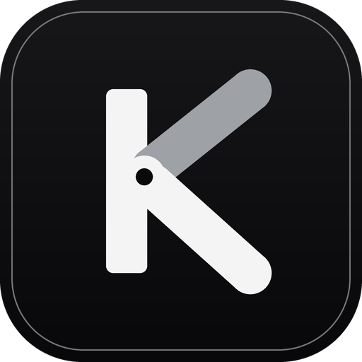
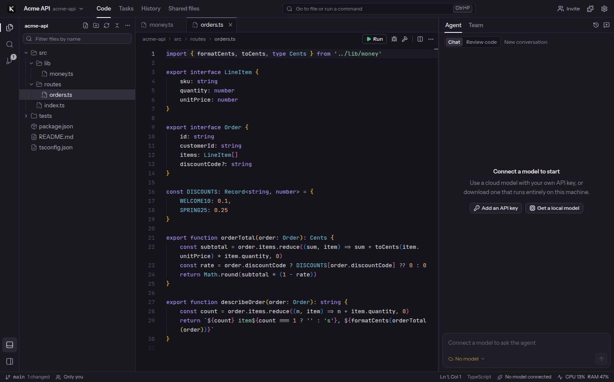
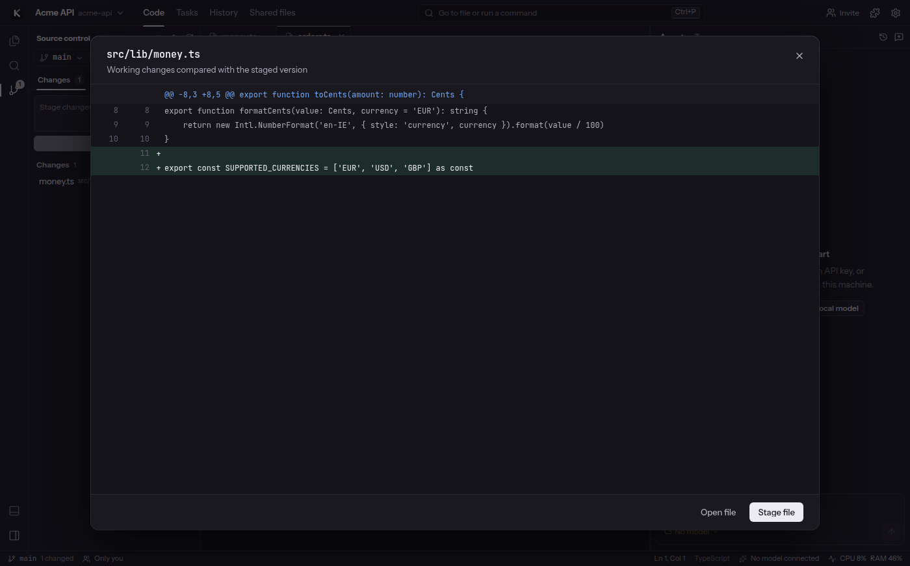
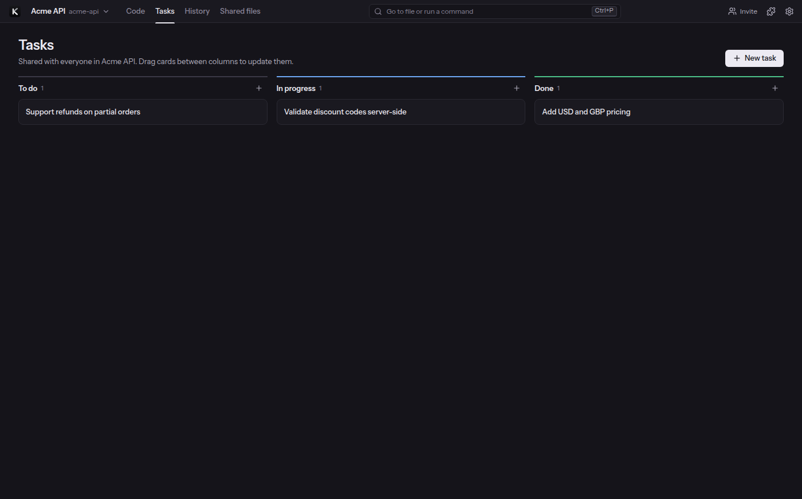
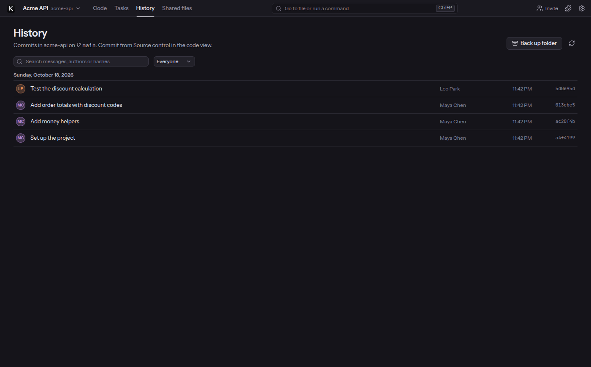
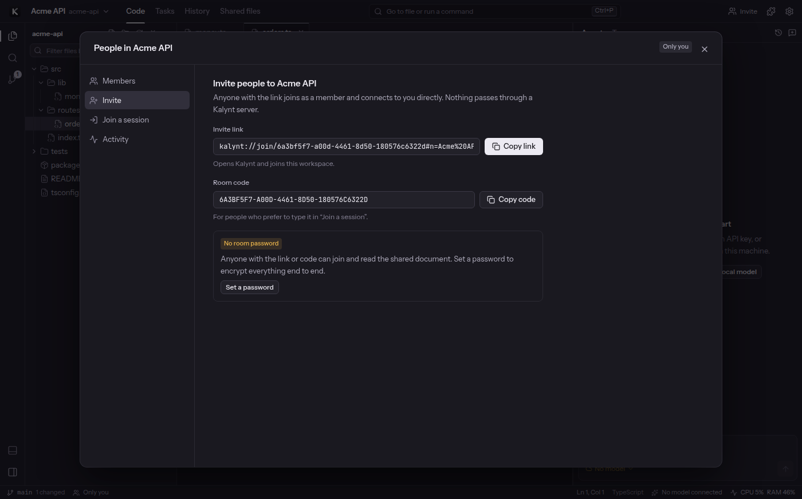
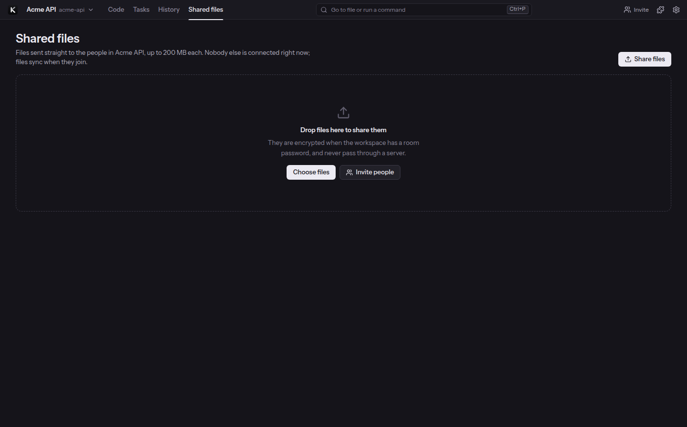
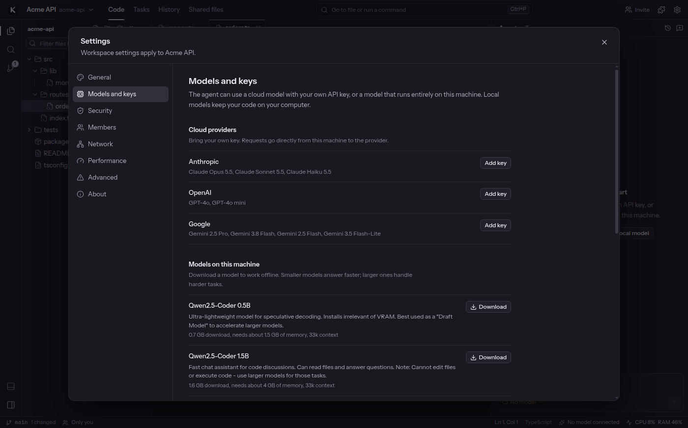
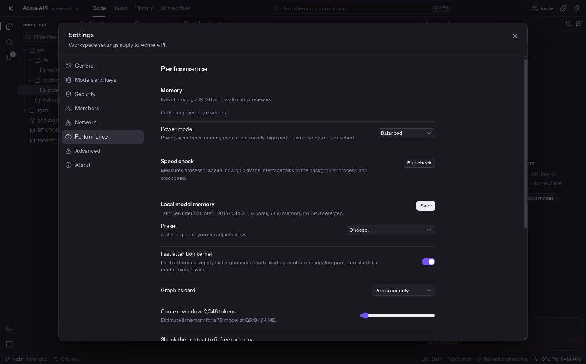
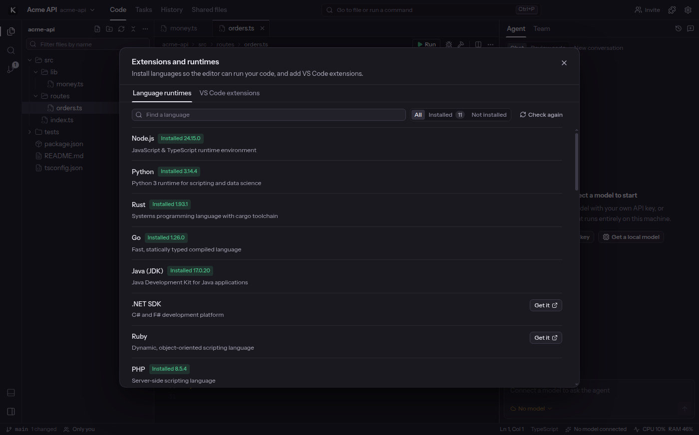

# Kalynt - The Privacy-First AI IDE

<div align="center">
  

  <h3>Local-First AI. Peer-to-Peer Collaboration. No Subscription Required.</h3>

  <p>
    Kalynt is a desktop code editor with an AI agent built in. Run models on your own machine or bring your own API key,
    and edit together with your team directly, peer to peer, without a server in between.
  </p>

  [](https://www.gnu.org/licenses/agpl-3.0)
  [](https://github.com/trisle-app/Kalynt/releases)
  [](https://github.com/trisle-app/Kalynt/releases)
  [](https://reddit.com/r/Kalynt_IDE)
  [](https://youtu.be/pV7THS2ZGls)
  [](https://open.spotify.com/show/0Hm1TtyPtzpRkhGCZjaAbb)
</div>

---

<div align="center">
  
</div>

<details>
  <summary><b>More screenshots</b></summary>

  ### Source control and diffs
  

  ### Task board
  

  ### History
  

  ### Inviting people
  

  ### Shared files
  

  ### Models and keys
  

  ### Local model memory (AIME)
  

  ### Language runtimes
  

</details>

## What's new in 2.0

Kalynt 2.0 is the first stable release: a rebuilt interface and a reliability pass over every backend service. Highlights:

*   **A new interface** with a home screen, per-workspace folders, full-page Tasks, History and Shared files views, a command palette, and light and dark themes.
*   **Current cloud models:** Claude Opus 5.5, Sonnet 5.5 and Haiku 5.5, GPT-4o, and Gemini 2.5 and 3.x.
*   **Local AI that works in the installed app**, with MemoryGuard to free memory before your machine starts swapping.
*   **A rewritten debugger** for Python, Node.js, C/C++ and Go.
*   **"Stop all processes" stops only what Kalynt started**, never unrelated programs.

See the [changelog](./CHANGELOG.md) for the full list.

## Features

### AI agent
*   **Local or cloud.** Run GGUF models on your CPU or GPU through `node-llama-cpp`, or use your own Anthropic, OpenAI or Google API key. Requests go straight from your machine to the provider.
*   **Agent with tools.** The agent reads and edits files, searches the workspace and runs commands. Every action asks first: deny it, allow it once, or allow it for the session.
*   **Checks its own edits.** After the agent changes a file, Kalynt runs that language's checker and hands any errors back so the agent can fix them.
*   **Code review.** A *Review code* mode scans the workspace and suggests fixes you can apply.
*   **AIME, the AI memory engine.** Indexes your codebase in the background so the agent has context, and manages local model memory: context window, GPU offload, threads, batch size, reserved RAM, and automatic unloading when memory runs low or the model sits idle.
*   **Model manager.** Download curated models (Qwen2.5-Coder, Qwen3, Devstral and more) with pause and resume.

### Editor and tools
*   **Monaco editor** (the core of VS Code) with split view, breadcrumbs, and optional AI inline completions.
*   **Terminal** built on xterm.js and node-pty, with search and multiple sessions.
*   **Run** the current file in 25 languages, **build** with your project's tasks (`tasks.json`, npm scripts and more), and **debug** Python, Node.js, C/C++ and Go with breakpoints, call stacks and expression evaluation.
*   **Source control:** stage, commit, branch, pull and push, with a diff view.
*   **Workspace search** with regex and replace preview, and a **command palette** for files, commands and workspaces.
*   **Language runtimes:** detect, install and remove 34 runtimes from one place.
*   **VS Code extensions** from the Open VSX marketplace or a local `.vsix`, running in a separate process.

### Working together
*   **Peer-to-peer sync** with Yjs CRDTs over WebRTC. Invite people with a link or a room code.
*   **End-to-end encryption** (AES-256-GCM) when the workspace has a room password. Without one, anyone with the link can join.
*   **Shared task board, team chat, member roles and file sharing** (up to 200 MB per file), all synced directly between peers.

### Privacy and security
*   **Local-first:** your code, conversations and index stay on your disk.
*   **API keys** are kept in the operating system's keychain through Electron's `safeStorage`.
*   **Sandboxed renderer** (`contextIsolation`, `sandbox`, no `nodeIntegration`) and a strict Content Security Policy.
*   **Every file operation** is checked against the workspace folder, with symlinks resolved.
*   **No shell is spawned** for run, build or package commands; arguments are passed as lists.

See [SECURITY.md](./SECURITY.md) for details and how to report a vulnerability.

---

## Platforms

*   **Linux** (AppImage and .deb): 2.0.0 was tested end to end on Ubuntu, in both development and packaged builds.
*   **Windows** (installer) and **macOS** (DMG, with a Swift native helper on Apple Silicon): built by CI from the same code.

Local models use your GPU where `node-llama-cpp` supports it (CUDA, Vulkan, Metal) and fall back to the CPU otherwise.

---

## Architecture

*   **Runtime:** Electron 40 (main process) and Chromium (renderer)
*   **Interface:** React 18, TypeScript (strict), Vite 7, a small in-house design system with CSS variables
*   **Editor and terminal:** Monaco Editor, xterm.js and node-pty
*   **State:** Zustand, with Yjs for shared workspace data
*   **AI:** `node-llama-cpp` for local models; Anthropic, OpenAI and Google APIs for cloud models
*   **Storage:** IndexedDB, better-sqlite3 and Electron `safeStorage`
*   **Icons:** Lucide

See [ARCHITECTURE.md](./ARCHITECTURE.md) for how the pieces fit together.

### Monorepo structure

> This repository contains **two separate projects** that are built and distributed separately:
> - **Kalynt Desktop**, the Electron IDE (this README)
> - **Kalynt Mobile Companion**, an Android app for remote management ([README_KALYNT_MOBILE.md](./README_KALYNT_MOBILE.md))

```text
kalynt/
├── apps/
│   ├── desktop/                 # Kalynt Desktop (Electron)
│   │   ├── electron/            # Main process: IPC handlers, services, terminal, extensions
│   │   ├── src/                 # Renderer: React UI, stores, services
│   │   └── scripts/             # Build hooks (after-pack.cjs)
│   └── mobile/                  # Android companion app (separate project)
│
├── packages/
│   ├── crdt/                    # Shared Yjs CRDT logic
│   ├── networking/              # P2P WebRTC management
│   ├── shared/                  # Common types and utilities
│   └── native-macos/            # Swift native helper (FSEvents, CoreML, memory)
└── ...
```

The desktop and mobile apps don't include each other's code. They talk over a local WebSocket bridge when you pair a phone.

---

## Installation

### Pre-built binaries
Download the installer for Windows, macOS or Linux from the [releases page](https://github.com/trisle-app/Kalynt/releases). Kalynt checks for updates and asks before downloading one.

### Building from source

```bash
# Prerequisites: Node.js >= 22, Python 3.10+, a C++ toolchain
git clone https://github.com/trisle-app/Kalynt.git
cd Kalynt
npm install
npm run electron:dev
```

To build installers for your platform:

```bash
cd apps/desktop
npx tsc && npx vite build && npx electron-builder
```

For the macOS native helper:
```bash
cd packages/native-macos
swift build -c release
```

---

## Contributing

We welcome contributions! See [CONTRIBUTING.md](./CONTRIBUTING.md) for how to submit pull requests, report bugs and request features.

---

## Community and support

*   **Reddit:** [r/Kalynt_IDE](https://reddit.com/r/Kalynt_IDE): support, feature requests and discussion
*   **YouTube:** [Kalynt channel](https://youtu.be/pV7THS2ZGls): demos and tutorials
*   **Spotify:** [Kalynt podcast](https://open.spotify.com/show/0Hm1TtyPtzpRkhGCZjaAbb)
*   **GitHub:** [issues](https://github.com/trisle-app/Kalynt/issues) for bugs and feature requests

---

## Licensing

Kalynt is free and open-source software licensed under the **GNU Affero General Public License v3.0 (AGPL-3.0)**.

Files marked with `SPDX-License-Identifier: AGPL-3.0-only` are free to use, modify, and distribute under the terms of the AGPL.

Copyright (c) 2026 Hermes Lekkas (hermeslekkasdev@gmail.com).
